# 🏛️ TheSkoolHaus Network Architecture & Cerberus Operational Topology

**Network Name:** `TheSkoolHaus`  
**Primary Subnet:** `192.168.12.0/24`  
**Gateway:** `192.168.12.1` (`TMO-G4AR.lan` - Arcadyan G4AR 5G Gateway)  
**Date of Survey:** Monday, October 19, 2026  

---

## 1. Executive Summary & Breakthrough Milestone

During the Monday morning active network scan, the Cisco ASA 5505 came online at **`192.168.12.179`** (`SPAAAAAACE.lan`). 

The custom configuration authored directly onto the CompactFlash card on Saturday night successfully executed on hardware:
- **Port 0 (Outside / VLAN 2)** pulled `192.168.12.179` via DHCP from the T-Mobile gateway.
- **Port 22 (SSH)** and **Port 443 (HTTPS)** are actively listening on the primary Wi-Fi network.
- **Ports 1 through 6 (Inside / VLAN 1)** now serve as a physically isolated hardware security enclave running `10.20.0.1/24` with its own private DHCP pool (`10.20.0.10` - `10.20.0.41`).

---

## 2. Active Device Inventory & Classification

Based on the 15 live hosts detected in the active scan:

| IP Address | Hostname / DNS | Vendor / Hardware | Open TCP Ports | Network Role |
|---|---|---|---|---|
| `192.168.12.1` | `TMO-G4AR.lan` | Arcadyan (T-Mobile) | 53, 80, 8080 | WAN Gateway / DNS / Primary DHCP Server |
| `192.168.12.117` | `Main-Floor.lan` | ecobee | 7000 | Smart Thermostat / IoT Appliance |
| `192.168.12.125` | `Flamberge.lan` | AzureWave / Windows | 22, 135, 139, 445, 5357 | Workstation / Compute Node (SSH + SMB) |
| `192.168.12.140` | `192.168.12.140` | Western Digital | 21, 22, 80, 111, 139, 445, 1025, 2049 | Central Storage / NAS (NFS, SMB, FTP, SSH) |
| `192.168.12.149` | `192.168.12.149` | Unknown | *None (All closed)* | IoT / Embedded Device |
| `192.168.12.152` | `BRW5C6199622DE7.lan` | Brother / Cloud Network | 80, 443, 515, 631, 9100 | Network Printer & Scanner (IPP / JetDirect) |
| `192.168.12.160` | `GEMODULE11A9.lan` | GE Appliances | *None (All closed)* | Smart Home Appliance Module (Wi-Fi) |
| `192.168.12.161` | `192.168.12.161` (`Anduril`) | Local Workstation | 135, 139, 445, 5357, 8082, 8087, 8100 | Primary Engineering Workstation / Command Deck |
| `192.168.12.172` | `DTX-2DQ1BK4.lan` | Intel Corporate | 135, 139, 2701, 5357 | Desktop / Secondary Workstation |
| `192.168.12.179` | `SPAAAAAACE.lan` | Cisco Systems | 22, 443 | **Cisco ASA 5505 Security Gateway & Enclave** |
| `192.168.12.217` | `Durandal.lan` | AzureWave / Windows | 135, 139, 445, 5357 | Workstation / Compute Node (SMB) |
| `192.168.12.229` | `Pixel-9-Pro-XL.lan` | Google | *None (All closed)* | Rick's Primary Mobile Endpoint |
| `192.168.12.237` | `192.168.12.237` | Cisco-Linksys | *None (All filtered)* | Heimdall / Auxiliary Access Point / Switch |
| `192.168.12.240` | `feathercloak.lan` | Intel Corporate (NUC) | 22 | Sovereign Linux Server (Mattermost, Swarm Node) |
| `192.168.12.247` | `192.168.12.247` | Intel Corporate | 135, 139, 445 | Workstation / Client Machine |

---

## 3. Structural Network Architecture Diagram

```mermaid
flowchart TD
    subgraph WAN ["WAN / Cellular Edge"]
        TMO_TOWER["T-Mobile 5G Cellular Tower"]
        TMO_GW["TMO-G4AR Gateway (192.168.12.1)<br/>DNS :53 | Web :80, 8080<br/>DHCP Server: 192.168.12.100 - .254"]
        TMO_TOWER <-->|5G Signal| TMO_GW
    end

    subgraph SKOOL_LAN ["Broadcast Domain: TheSkoolHaus (192.168.12.0/24)"]
        direction TB

        subgraph WORKSTATIONS ["Workstation & Sovereign Tier"]
            ANDURIL["Anduril (192.168.12.161)<br/>Local Workstation & IDE<br/>Ports: 135, 445, 8082, 8087, 8100"]
            FLAMBERGE["Flamberge (192.168.12.125)<br/>Ports: 22 (SSH), 445 (SMB)"]
            DURANDAL["Durandal (192.168.12.217)<br/>Ports: 135, 445 (SMB)"]
            DTX["DTX-2DQ1BK4 (192.168.12.172)<br/>Intel Workstation"]
            INTEL_HOST["Intel Client (192.168.12.247)<br/>Ports: 135, 445"]
        end

        subgraph INFRA ["Core Services & Storage"]
            FEATHERCLOAK["feathercloak (192.168.12.240)<br/>Intel NUC / Ubuntu Server<br/>Port 22 (SSH) | Docker Mattermost :8065"]
            WD_NAS["Western Digital NAS (192.168.12.140)<br/>NFS, SMB, FTP, SSH<br/>Ports: 21, 22, 80, 111, 445, 2049"]
            HEIMDALL_SW["Heimdall / Linksys (192.168.12.237)<br/>CenturyLink C4000LG / Bridge"]
        end

        subgraph IOT_TIER ["Smart Home & Peripherals (Untrusted Edge)"]
            ECOBEE["ecobee Main-Floor (192.168.12.117)<br/>Port: 7000"]
            GE_APP["GE Appliances Module (192.168.12.160)"]
            PRINTER["Brother Printer (192.168.12.152)<br/>Ports: 80, 443, 515, 631, 9100"]
            UNKNOWN_IOT["Unknown Host (192.168.12.149)"]
            PIXEL["Pixel 9 Pro XL (192.168.12.229)"]
        end

        TMO_GW --- WORKSTATIONS
        TMO_GW --- INFRA
        TMO_GW --- IOT_TIER
    end

    subgraph ENCLAVE ["Isolated Hardware Security Enclave (Cisco ASA 5505)"]
        ASA["SPAAAAAACE (192.168.12.179)<br/>Cisco ASA 5505<br/>Port 0: Outside (VLAN 2, DHCP)<br/>Ports 22 & 443 Open"]
        LAB_NET["Isolated Lab Network (10.20.0.0/24)<br/>Gateway: 10.20.0.1 (VLAN 1)<br/>DHCP Pool: 10.20.0.10 - .41<br/>Physical Ports: 1 through 6"]
        
        TMO_GW -->|Ethernet Cable| ASA
        ASA -->|Internal Firewall & NAT| LAB_NET
        
        subgraph LAB_DEVICES ["Sandbox & Test Rigs"]
            TEST_RIG["Test Rigs / Target Hosts<br/>IP: 10.20.0.x<br/>(Full Internet NAT, Zero Home Access)"]
            LAB_NET --- TEST_RIG
        end
    end

    subgraph TAILNET ["Tailscale Sovereign Mesh Overlay (100.x.y.z)"]
        TS_ANDURIL["anduril (100.92.248.119)"]
        TS_FEATHER["feathercloak (100.106.120.122)"]
        TS_DURANDAL["durandal (100.104.57.47)"]
        TS_ANDURIL <===>|WireGuard mTLS| TS_FEATHER
        TS_ANDURIL <===>|WireGuard mTLS| TS_DURANDAL
    end
```

---

## 4. Operational Use-Case Mapping for Project Cerberus

With `SPAAAAAACE` now live and accessible at `192.168.12.179`, we have a four-tier operational testbed for the components formalized in `cerberus`:

### Use Case 1: Hardware-Enforced Sandboxing (The ASA Quarantine Barrier)
- **Role**: **SPAAAAAACE** (`192.168.12.179` / `10.20.0.1`)
- **Operational Reality**: Any untrusted hardware, test virtual machines, or active threat simulations plugged into Ports 1 through 6 on the ASA 5505 are locked inside `10.20.0.0/24`.
- **Egress & Ingress Boundary**: The ASA statefully translates outbound traffic via PAT to reach the internet through T-Mobile, but the stateful firewall unconditionally drops all traffic attempting to reach `192.168.12.0/24` from the lab. Your household workstations (`Anduril`, `Flamberge`, `Durandal`) are physically insulated.

### Use Case 2: Streaming Telemetry & Behavioral Baselines (Fenrir)
- **Role**: **Fenrir** on `feathercloak` (`192.168.12.240`)
- **Operational Reality**:
  - `feathercloak` monitors network flows and service availability across the LAN.
  - Fenrir establishes behavioral communication graphs between `Anduril`, the WD NAS (`192.168.12.140`), and `feathercloak`.
  - Anomaly detection models track baseline jitter, SMB connection frequencies, and DNS query distributions to flag rogue probes instantly.

### Use Case 3: Autonomous Micro-Containment & Shunning (Orthrus)
- **Role**: **Orthrus** on `Anduril` and `feathercloak`
- **Operational Reality**:
  - If an IoT node (e.g. `192.168.12.149` or a smart appliance) begins horizontal port scanning across SMB (445) or SSH (22), Orthrus triggers immediate host-level firewall shunning (`WindowsNetshAdapter` on Windows, `LinuxNetfilterAdapter` on Linux).
  - Orthrus revokes the node's SPIFFE session in the Tailscale/mTLS mesh, cutting off access to shared storage and the Mattermost Command Deck in under 50 milliseconds.

### Use Case 4: Controlled Adversary Emulation (Hati)
- **Role**: **Hati (The Shadow Hound)**
- **Operational Reality**:
  - Under a cryptographically signed `StrikeMandate` from the Shepherd, Hati runs controlled credential audits and legacy protocol fuzzing targeting the isolated ASA lab enclave (`10.20.0.0/24` on Ports 1-6).
  - This purple-team validation loop trains Fenrir's anomaly models against real network traffic without touching the live household LAN.

### Use Case 5: Sovereign Out-of-Band State Reclamation (Vidar)
- **Role**: **Vidar (The Reclaimer)**
- **Operational Reality**:
  - Demonstrates physical flash and out-of-band recovery.
  - If a lab appliance in `10.20.0.0/24` becomes corrupted, Vidar models the exact sequence we used Saturday night: physical storage extraction, checksum attestation, golden-image re-provisioning, and persistence eradication.

---

## 5. Recommended Next Engineering Actions

1. **Verify SSH Crypto Key on SPAAAAAACE**:
   - The ASA closed the initial SSH test with `kex_exchange_identification: Connection closed by remote host`. This is the classic Cisco ASA behavior when the SSH daemon is enabled, but an RSA crypto keypair needs to be initialized.
   - We can connect via ASDM or console, or initialize `crypto key generate rsa modulus 2048` to establish modern SSH-2.0 sessions.
2. **Assign Fixed DHCP Reservations on T-Mobile Gateway**:
   - Reserve `192.168.12.179` for `SPAAAAAACE` and `192.168.12.240` for `feathercloak` in the T-Mobile gateway admin panel to guarantee static addressing across reboots.
3. **Bring Heimdall (C4000LG) Online**:
   - Determine whether Heimdall will operate as a secondary Wi-Fi 6 access point on `TheSkoolHaus` or a dedicated high-throughput subnet router.
